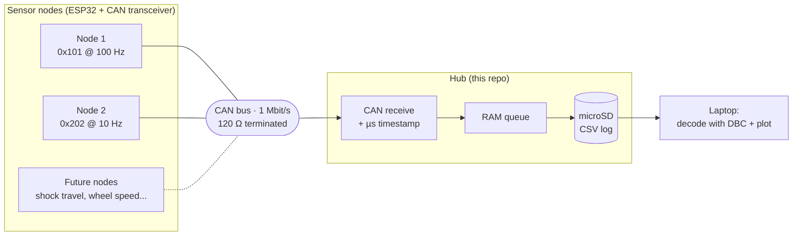
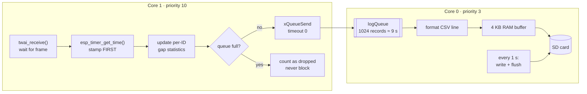
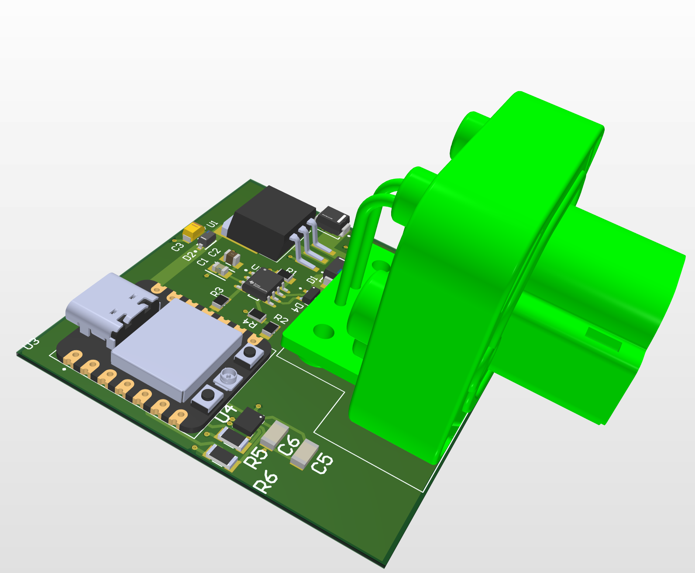

# Baja SAE Data Acquisition: Hub Firmware


Firmware for the central **data logging hub** of Ohio University's Baja SAE off-road vehicle. Sensor nodes around the car publish readings on a shared **CAN bus**. The hub receives every frame, stamps it with a **microsecond timestamp**, and logs it to an **SD card** without ever letting a slow card cost a CAN frame.

The DAQ system is being built from scratch by a five-person subteam, each owning one workstream. **I own the hub firmware:** CAN receive, timestamping, buffering, SD logging, and the tools to check the logs.

> **How this was built:** The firmware was written with AI assistance (Claude). The design decisions, hardware bring-up, wiring, debugging, and testing were done by me on the team's bench.

---

## System overview



Every node sends a **heartbeat** once a second and puts a **running counter** in its data frames. A gap in the counter means a frame was lost somewhere, which is how the system proves it isn't dropping data.

---

## How the hub works

The ESP32 has two CPU cores. The firmware splits the work so the time-critical part never waits on the slow part.



### Design decisions

| Problem | What the firmware does |
|---|---|
| Timestamps must reflect when a frame **arrived**, not when the code got around to it | The receive task stamps the frame with `esp_timer_get_time()` before doing anything else, and runs at high priority on its own core. |
| SD cards randomly **stall** for tens to hundreds of milliseconds while writing | A FreeRTOS queue sits between the two tasks. At the test traffic rate (~112 frames/s) it holds about 9 s of data, so a stall just fills the queue for a moment. |
| If the queue ever does fill, the CAN side must not freeze | `xQueueSend(..., 0)` never waits. A lost record is **counted** and shown in the status report, so losses can't hide. |
| The car's **kill switch** cuts power at every run | The SD task writes and flushes the file at least once per second, so a power cut costs at most about 1 s of data. |
| Old logs must never be overwritten | Each power-up opens the next free name (`LOG0001.CSV`, `LOG0002.CSV`, ...). |
| Pulling the card mid-write corrupts it | The board's button closes the file cleanly. The red LED shows when it's logging. A removed or failed card is detected and retried every 2 s. |
| Two tasks share statistics | Shared data is guarded by a spinlock (`portMUX`). The report copies a snapshot under the lock, then prints with the lock released so printing never delays a frame. |
| Electrical noise can push a node **bus-off** | Test nodes detect bus-off, recover automatically, and count each recovery in their report. |

---

## Log format

Plain CSV, one line per CAN frame, so it opens in anything:

```
t_us,id,dlc,data
5012345,101,4,000001F3
5022351,101,4,000001F4
5100840,202,4,0000001A
```

| Column | Meaning |
|---|---|
| `t_us` | Hub timestamp, microseconds since boot |
| `id` | CAN ID (hex) |
| `dlc` | Number of data bytes (0–8) |
| `data` | Data bytes as hex |

---

## Hardware (bench prototype)

| Part | Hub | Test nodes |
|---|---|---|
| Microcontroller | Adafruit Feather ESP32 V2 | Seeed XIAO ESP32-C3 |
| CAN transceiver | TK109 module | TK109 module |
| Storage | 3.3 V microSD module (SPI, 4 MHz) | — |
| CAN controller | ESP32 built-in TWAI | ESP32 built-in TWAI |

<details>
<summary><b>Hub pin map</b></summary>

| Signal | Feather pin | GPIO |
|---|---|---|
| CAN TX → transceiver CTX | A5 | 4 |
| CAN RX ← transceiver CRX | D33 | 33 |
| SD SCK | SCK | 5 |
| SD MISO | MI | 21 |
| SD MOSI | MO | 19 |
| SD CS | D32 | 32 |
| Log stop/start button | SW38 | 38 |
| Logging LED | D13 | 13 |

CAN RX was moved off GPIO5 in Stage D because the SD card needed the SPI clock pin.
</details>

### CAN test node PCB



I also designed a CAN sensor node in **Altium Designer**: an ESP32-C3, a CAN transceiver with bus protection, 12 V vehicle power regulated to 5 V, and an automotive 6-axis IMU, all behind a Deutsch DT connector. **[Schematics, layout, and design notes →](hardware/)**

---

## Repository layout

```
baja-daq/
├── firmware/
│   ├── hub/
│   │   ├── HubStageC/      CAN receive + µs timestamps + per-ID timing report
│   │   └── HubStageD/      Stage C + buffered SD logging (current hub firmware)
│   ├── test-node/
│   │   └── CANTwoNode/     Traffic generator: data + heartbeats + loss counting
│   └── diagnostics/
│       ├── CANLoopCheck/   Checks transceiver wiring with a multimeter, no CAN controller
│       └── CANSelfTest/    One-board loopback test of the full CAN path
├── tools/
│   └── SDReader/           Inspect and verify log files over USB serial
└── hardware/               CAN accelerometer test node PCB (Altium)
```

### Development stages

The hub was built up in stages, each one tested on the bench before adding the next.

| Stage | Adds | Sketch |
|---|---|---|
| C | Receive every frame, timestamp it, report average/min/max gap per ID to confirm the timing matches the send rate | `HubStageC` |
| D | Second task on core 0, RAM queue, CSV logging to SD, 1 s flush, safe-stop button, card hot-swap retry | `HubStageD` |

### Debugging tools

Bringing up CAN on a breadboard means a lot of "is it the wiring or the code?" These sketches split that question into pieces:

1. **`CANLoopCheck`** drives the transceiver's TX pin by hand and reads RX back. No CAN controller involved, so it isolates the wiring and transceiver.
2. **`CANSelfTest`** uses the ESP32's CAN controller in no-ACK self-reception mode, testing one board's full path without needing a second node.
3. **`CANTwoNode`** runs two real nodes against each other and reports error counters, bus-off events, and lost frames.
4. **`SDReader`** reads the hub's SD card over USB with simple commands (`ls`, `check N`, `head N`, `tail N`, `cat N`). `check` reports lines per ID, timing gaps, and lost frames from the counters. `tail` is for the power-cut test: it shows the last lines that survived.

---

## Running it

1. Install the [Arduino IDE](https://www.arduino.cc/en/software) and the **esp32 by Espressif** board package (Boards Manager).
2. Open a sketch folder, for example `firmware/hub/HubStageD/HubStageD.ino`.
3. Select the board (**Adafruit Feather ESP32 V2** for the hub, **XIAO_ESP32C3** for nodes) and upload.
4. For the test nodes, set `NODE_ID` to `1` on one board and `2` on the other before flashing.
5. Open the Serial Monitor at **115200 baud**. The hub prints a timing and logging report every second.

---

## Roadmap

- [x] Receive CAN frames with microsecond timestamps
- [x] Per-ID timing statistics
- [x] Buffered SD logging that can't block CAN receive
- [x] On-device log checker (`SDReader`)
- [ ] Kill-switch power-cut test: ≤ 1 s of data lost, no corrupted files
- [ ] Python decoder: raw log → CSV in real units using the team's DBC file
- [ ] Plot script for every signal against time
- [ ] 1-hour log with zero dropped frames
- [ ] Move from breadboard to the ESP32-S3 hub PCB

---

## What I learned

- Structuring firmware around **FreeRTOS tasks pinned to cores**, with a producer/consumer queue between them
- How **CAN** works at the electrical and protocol level: dominant/recessive bits, ACK, error counters, bus-off recovery, and termination
- Why **SD cards stall** and how buffering absorbs it
- Debugging hardware **one layer at a time**, writing small sketches that each test a single piece
