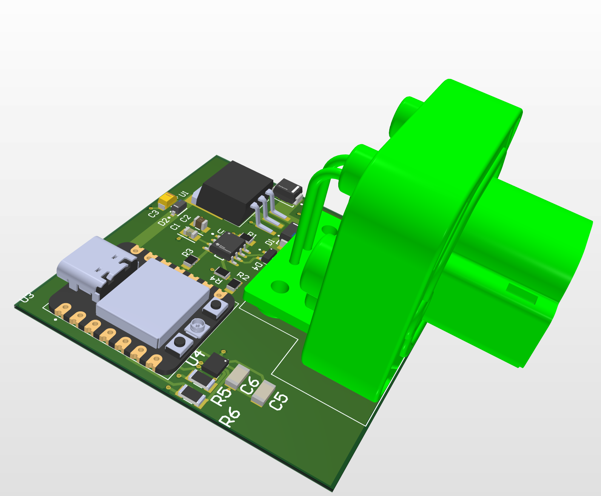
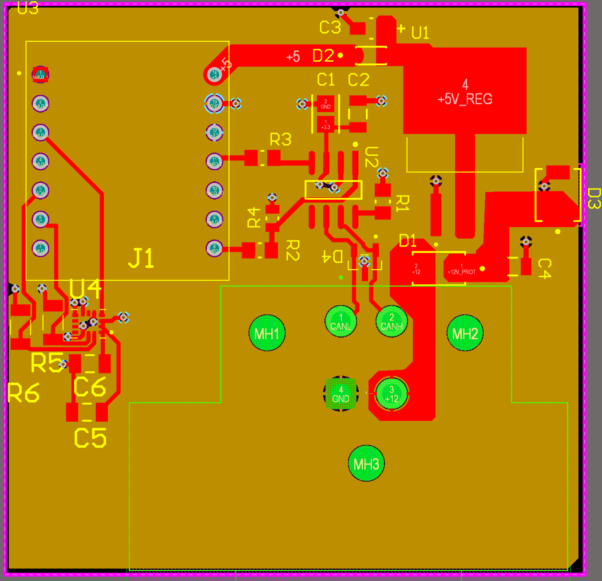
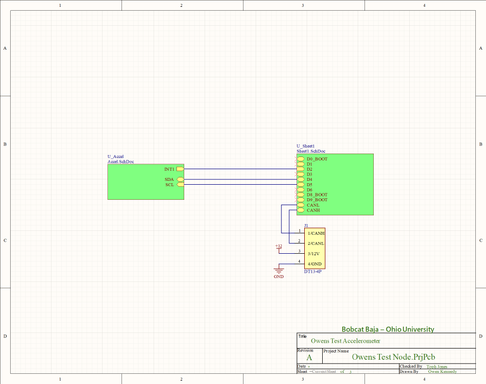
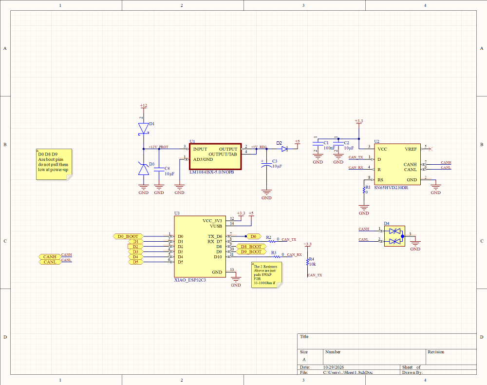
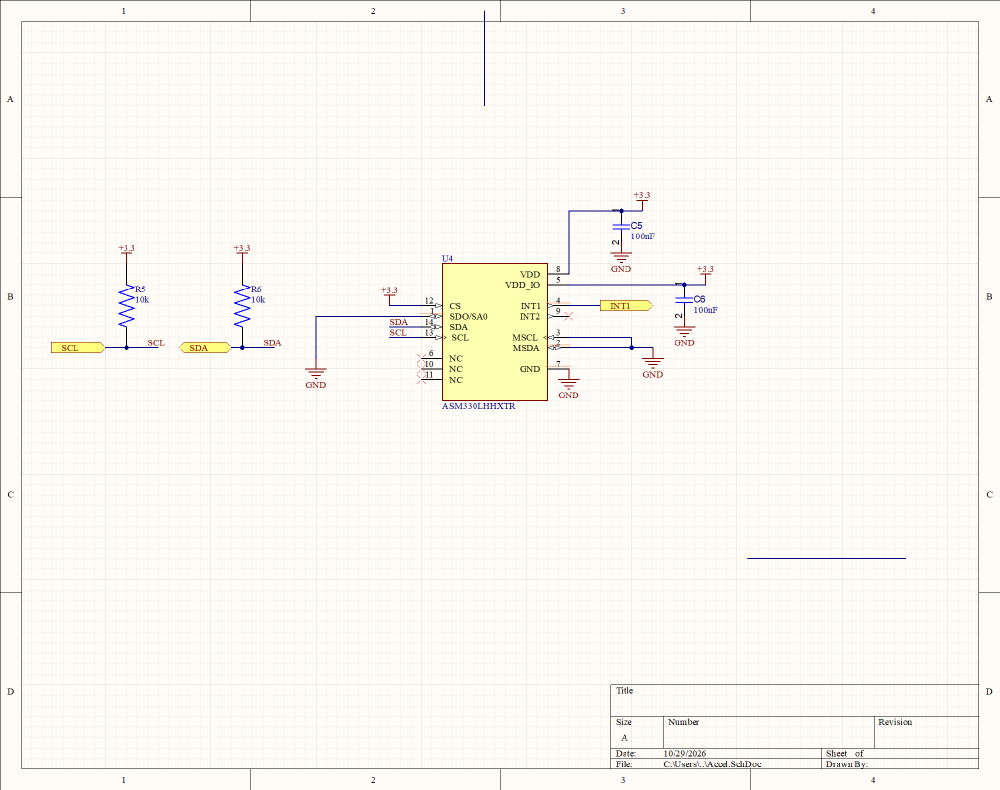

# CAN Accelerometer Test Node (Altium)

A small CAN bus sensor node for the Baja SAE data acquisition system, designed in **Altium Designer**. It plugs into the vehicle's CAN bus through a Deutsch DT connector, reads a 6-axis automotive IMU (accelerometer + gyroscope), and sends the data to the hub.

Every member of the DAQ team designed a CAN test node as part of learning Altium. Mine adds an IMU to the base design.

**Status:** schematic and layout complete; not yet fabricated.

---

## Layout

## Schematics

The design is hierarchical: a top sheet connects the CAN/power sheet and the IMU sheet.

| Top level | CAN interface + power | IMU |
|---|---|---|
|  |  |  |

---

## How the board works

| Block | Parts | What it does |
|---|---|---|
| Microcontroller | **U3** Seeed XIAO ESP32-C3 | Runs the node firmware; its built-in TWAI controller handles CAN |
| CAN transceiver | **U2** TI SN65HVD230 (3.3 V) | Converts the ESP32's TX/RX logic signals to the differential CANH/CANL bus |
| CAN protection | **D4** dual TVS diode | Clamps ESD and voltage spikes on CANH/CANL |
| Boot-safe TX | **R4** 10 kΩ pull-up | Holds CAN TX recessive while the ESP32 boots, so the node can't disturb the bus at power-up |
| Series pads | **R2, R3** 0 Ω | Placeholders that can be swapped for 33–100 Ω resistors if signal ringing shows up |
| Slope control | **R1** 0 Ω to GND | Puts the transceiver in high-speed mode (needed for 1 Mbit/s) |
| Power input | **D1** series diode, **D3** TVS, **C4** | Reverse-polarity protection and transient clamping on the vehicle's 12 V |
| Regulator | **U1** LM1084-5.0 LDO, **C3** | 12 V → 5 V for the XIAO |
| Backfeed diode | **D2** | Keeps USB power from back-feeding into the regulator when the XIAO is plugged into a laptop |
| IMU | **U4** ST ASM330LHHX, **C5, C6** | Automotive-grade 6-axis accelerometer + gyroscope |
| I2C | **R5, R6** 10 kΩ pull-ups | SDA/SCL to the XIAO; the IMU's INT1 interrupt pin is wired to a XIAO GPIO |
| Connector | **J1** Deutsch DT13-4P | CANH, CANL, +12 V, GND to the vehicle harness |
| Mounting | **MH1–MH3** | Mounting holes |

### Design notes

- The XIAO's boot-strapping pins (D0, D8, D9) are left unused by the sensor so they can't be pulled low at power-up.
- The IMU's CS pin is tied high to select I2C mode, and SA0 is tied low to fix its address.

### Known issue

On this revision, **J1 pin 1 carries CANL and pin 2 carries CANH**, which is swapped from the connector symbol's labels. A CAN swap can't be corrected in firmware: the transceiver reads the voltage *difference* between the wires, so a swapped dominant bit looks identical to a recessive bit. The mating harness for this board swaps pins 1 and 2 to compensate.

---

## Files

| File | Contents |
|---|---|
| `Owens Test Node.PrjPcb` | Altium project |
| `Owens Test Node.SchDoc` | Top-level schematic |
| `Sheet1.SchDoc` | CAN transceiver, microcontroller, and power |
| `Accel.SchDoc` | IMU |
| `Owens Test Node.PcbDoc` | PCB layout |
| `Owens Test Node.OutJob` | Fabrication output job (Gerbers, drill, BOM) |
